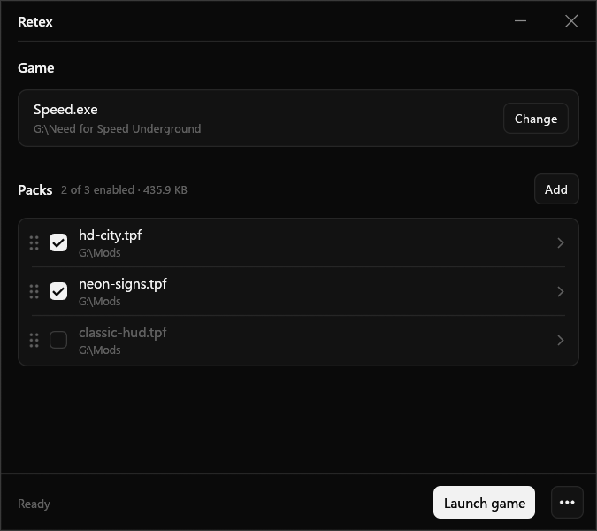
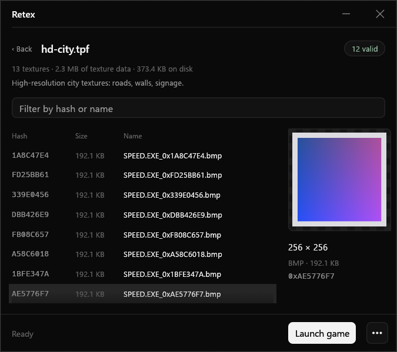

# Retex

A modern, open-source replacement for **TexMod**, the 2006 Direct3D 9
texture-replacement tool. Retex loads existing `.tpf` texture packs into D3D9
games: same packs, same texture hashes, no 2006-era packer or antivirus
warnings.

<p>
  
  
</p>

## Features

- **Works with existing packs.** Reads and writes TexMod `.tpf` files
  bit-for-bit, including TexMod's texture hash (and its row-padding bug), so
  packs made for TexMod match the same textures.
- **Small native app.** Pick the game, drop in packs, untick or reorder them,
  and launch. No browser runtime, no installer.
- **Two ways to load into the game.**
  - *Launch*: Retex starts the game and loads the hook as it starts. Nothing
    is copied into the game folder.
  - *ASI*: installs `retex.asi` for games that already use
    [Ultimate ASI Loader](https://github.com/ThirteenAG/Ultimate-ASI-Loader),
    so the game loads your packs however you start it.
- **One-click desktop shortcuts** that launch the game with your packs, using
  the game's icon.
- **Pack inspector.** Open any pack to verify it (CRCs, bitmaps,
  `texmod.def`), search textures by hash or name, and preview them.
- **Command-line tool** for listing, verifying, extracting and building packs.
- Large packs are indexed lazily, so a several-hundred-MB pack doesn't have to
  fit in a 32-bit game's memory.

## Download

Get the latest `retex-<version>-windows.zip` from
[Releases](https://github.com/Depth118/retex/releases), extract it anywhere,
and run `retex-app.exe`.

Keep the four program files together in one folder:

| File | Purpose |
|---|---|
| `retex-app.exe` | The desktop app |
| `retex.exe` | Command-line tool; the app uses it to launch, install and create shortcuts |
| `retex_hook.dll` | The 32-bit hook that replaces textures inside the game |
| `retex-inject.exe` | The 32-bit launcher that loads the hook into the game |

Requires Windows 10 or 11. Retex targets 32-bit Direct3D 9 games.

## Usage

1. Drop the game's `.exe` onto the window, or click the Game box to browse.
2. Click **Add** (or drop `.tpf` files) to add packs. Packs apply top to
   bottom: if two packs replace the same texture, the higher one wins. Drag
   to reorder; untick a pack to skip it.
3. Click **Launch game**.

The **⋯** menu next to Launch has:

- **Install ASI hook**: copies `retex.asi` and `retex.ini` into the game
  folder. The game needs Ultimate ASI Loader (usually `dinput8.dll`). Run it
  again after changing your packs. To uninstall, delete `retex.asi` and
  `retex.ini`.
- **Create desktop shortcut**: a shortcut that launches the game with your
  packs. Keep the Retex folder where it is afterwards; the shortcut points
  into it.
- **Inspect a pack file**: open any `.tpf` without adding it.

Settings are stored in `%APPDATA%\Retex\gui.json`. Running
`retex-app.exe path\to\pack.tpf` opens that pack's details directly.

## Command line

```
retex list    <pack.tpf> [--limit N]
retex verify  <pack.tpf>              # entries, CRCs, bitmaps, texmod.def
retex extract <pack.tpf> <out-dir> [--limit N]
retex build   <pack.tpf> <def-file> [--exe SPEED.EXE] [--comment "..."]
retex hash    <texture.bmp>

retex launch   <game.exe> [--pack <pack.tpf>]...
retex install  <game-dir> --pack <pack.tpf> [--hook <retex_hook.dll>]
retex shortcut <game.exe> --inject [--pack <pack.tpf>] [--name "My Game"]
```

`launch` starts the game suspended, loads `retex_hook.dll` into it, and
resumes it. The hook reads the pack list from `retex.ini` next to the game's
executable, so `--pack` just writes that file.

Definition files use TexMod's format, one texture per line:

```
0xA3891C0F|textures/road.bmp
0xA2A2ED86|textures/grass.bmp
```

## Building from source

Requires Rust 1.95 or newer, the MSVC build tools, and the 32-bit target:

```
rustup target add i686-pc-windows-msvc

cargo build --release -p retex-app -p retex-cli
cargo build --release -p retex-hook -p retex-inject --target i686-pc-windows-msvc
```

Or build everything and create the release zip in `dist\`:

```
powershell -ExecutionPolicy Bypass -File scripts\package.ps1
```

The app and CLI are 64-bit; the hook and injector must be 32-bit to load into
32-bit games.

## Project layout

```
crates/
  retex-core/    .tpf format, ZipCrypto, CRC, texture hash
  retex-cli/     `retex` command-line tool
  retex-hook/    32-bit D3D9 hook (ASI or injected)
  retex-inject/  32-bit launcher/injector
  retex-app/     egui desktop app
docs/            format specification and design notes
research/        reverse-engineering notes, scripts and reference code
scripts/         release packaging
```

## How it works

TexMod packs are ZIP archives, XOR-masked with `0x3FA43FA4` and encrypted with
ZipCrypto using a fixed 42-byte password. Each texture is identified by a
CRC-32 (polynomial `0xEDB88320`, no final XOR) over `bpp × width × height`
bytes of the locked surface, ignoring pitch. The full specification is in
[`docs/texmod-format.md`](docs/texmod-format.md); design notes are in
[`docs/design.md`](docs/design.md).

In the game, the hook intercepts `Direct3DCreate9`, wraps the device, and in
`SetTexture` hashes each texture and swaps in the pack's replacement, created
with `D3DXCreateTextureFromFileInMemory` like TexMod does.

Tested with *Need for Speed: Underground* and the 345 MB *Redux* pack, through
both the launcher and Ultimate ASI Loader, alongside ReShade.

## Notes

- Don't use Retex in online or anti-cheat-protected games.
- Windows 11 packaged (Store) apps block the launcher's injection; use ASI
  mode for those.
- Retex is an independent clean-room implementation, not affiliated with the
  original TexMod author. The original binaries are not included; see
  [`research/README.md`](research/README.md).

## License

Licensed under either of [Apache License 2.0](LICENSE-APACHE) or
[MIT license](LICENSE-MIT), at your option.

Third-party notices for the libraries and fonts included in the release
binaries are in [`THIRD-PARTY-LICENSES.txt`](THIRD-PARTY-LICENSES.txt)
(regenerate with `cargo about generate about.hbs -o THIRD-PARTY-LICENSES.txt`).
